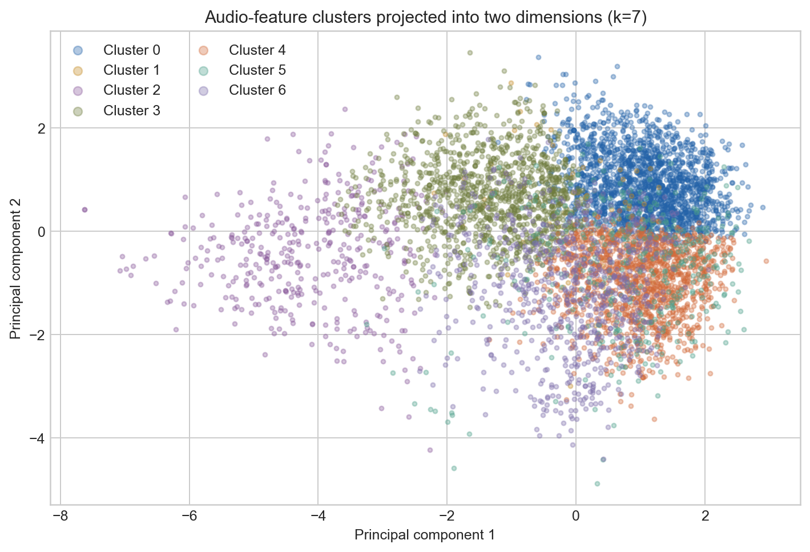
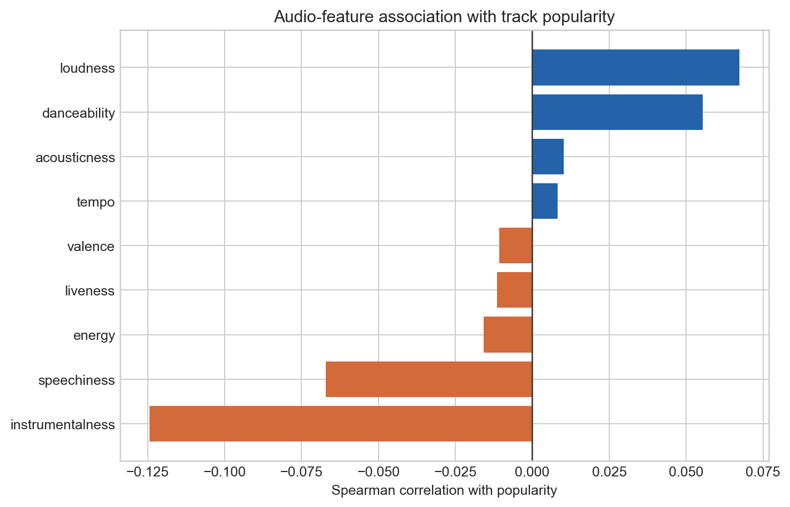
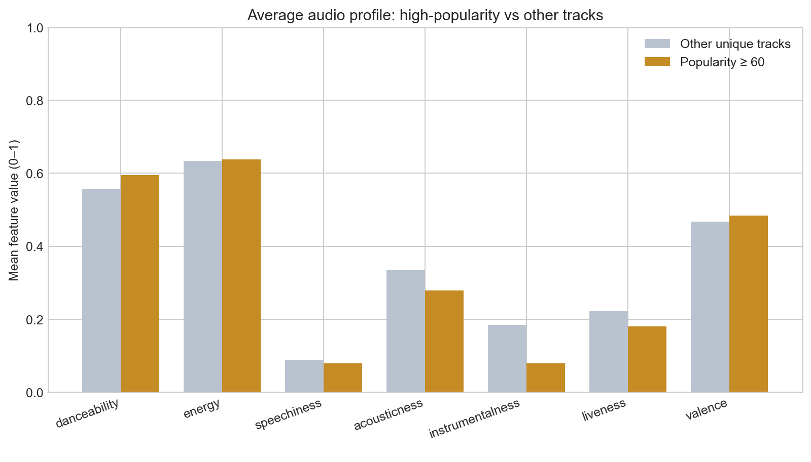
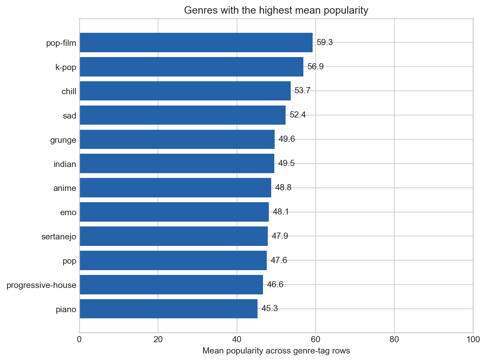

# Spotify Music Pattern Analysis

[](https://github.com/sagarmandavkar-UX/spotify-music-pattern-analysis/actions/workflows/ci.yml)
[](https://www.python.org/)
[](LICENSE)

What does a large Spotify catalog reveal about popularity, genre audio patterns, and natural groups of songs?

This project performs duplicate-aware exploratory analysis and unsupervised clustering across 114,000 Spotify genre-tag rows. It separates track-level and genre-tag-level questions, compares high-popularity tracks with the rest of the catalog, and treats clustering as exploratory rather than a claim that there are objectively “true” music segments.



## Key findings

- The source contains **114,000 genre-tag rows** but **89,741 unique track IDs**; 24,259 rows repeat a track under another genre.
- Mean popularity across unique tracks is **33.2 / 100**.
- The 90th-percentile high-popularity threshold is **60**, producing 9,807 high-popularity unique tracks.
- `instrumentalness` has the strongest audio-feature association with popularity, but it is weak and negative (**Spearman ρ = −0.124**).
- High-popularity tracks are, on average, less instrumental and less acoustic, slightly more danceable, and somewhat louder than other tracks.
- Seven audio clusters achieved the highest tested silhouette score, but the score is only **0.195**—evidence of overlapping styles, not cleanly separated segments.

## Popularity is not the same as a trend

The dataset contains one popularity score per row and no observation dates. Spotify popularity partly reflects recent plays, but this snapshot cannot show whether a track is rising, falling, or historically “trending.” The project therefore uses **high-popularity tracks**, not time trends, and makes no causal claim that changing an audio feature would increase success.

## Dataset

The [Spotify Tracks Dataset](https://www.kaggle.com/datasets/maharshipandya/-spotify-tracks-dataset) includes audio features and metadata across 114 genre labels:

- popularity, artists, album, and track name
- danceability, energy, loudness, speechiness
- acousticness, instrumentalness, liveness, valence
- tempo, duration, key, mode, and time signature

See [data/README.md](data/README.md) for attribution, the dataset license label, and analysis-grain decisions.

## Questions answered

### What audio features are associated with popularity?



All bivariate audio-feature correlations with popularity are small. This is an important result: popularity is not reducible to a simple audio formula, and metadata, artist reach, playlists, marketing, timing, and audience context are not represented here.

### How do high-popularity tracks differ?



The chart compares bounded 0–1 audio features for unique tracks above and below the catalog’s 90th-percentile popularity threshold. Differences are descriptive and potentially confounded by genre mix.

### Which genre labels have higher popularity in this snapshot?



`pop-film`, `k-pop`, and `chill` have the highest mean popularity among the genre-tag rows. These are dataset-specific label comparisons, not estimates of global genre audiences.

### Are there distinct audio-style clusters?


K-means models with 3–7 clusters were compared on a deterministic sample. The final seven-cluster solution is summarized on all unique tracks. The modest silhouette score and two-dimensional projection both show meaningful overlap.

## Analysis workflow

```text
114,000 genre-tag rows
       │
       ├── Genre comparisons retain genre-tag rows
       │
       └── Popularity + clustering deduplicate track_id
                    │
                    ▼
        Descriptive distributions and correlations
                    │
                    ▼
       High-popularity audio-profile comparison
                    │
                    ▼
     Standardize audio features → test k=3…7
                    │
                    ▼
        Profile clusters + PCA visualization
```

## Repository structure

```text
.
├── data/
│   ├── README.md
│   └── raw/                 # downloaded locally, not committed
├── notebooks/spotify_music_analysis.ipynb
├── reports/
│   ├── figures/
│   ├── cluster_profile.csv
│   ├── genre_profile.csv
│   ├── popularity_correlations.csv
│   └── summary.json
├── scripts/
├── src/spotify_analysis/
└── tests/
```

## Run locally

```bash
python -m venv .venv
source .venv/bin/activate
python -m pip install -e ".[dev]"
python scripts/download_data.py
python scripts/run_analysis.py
python scripts/build_notebook.py
jupyter nbconvert --execute --to notebook --inplace notebooks/spotify_music_analysis.ipynb
pytest -q
```

## Outputs

- [Executed analysis notebook](notebooks/spotify_music_analysis.ipynb)
- [Machine-readable summary](reports/summary.json)
- [Genre profile](reports/genre_profile.csv)
- [Cluster profile](reports/cluster_profile.csv)
- [Popularity correlations](reports/popularity_correlations.csv)
- [High-popularity audio profile](reports/high_popularity_audio_profile.csv)
